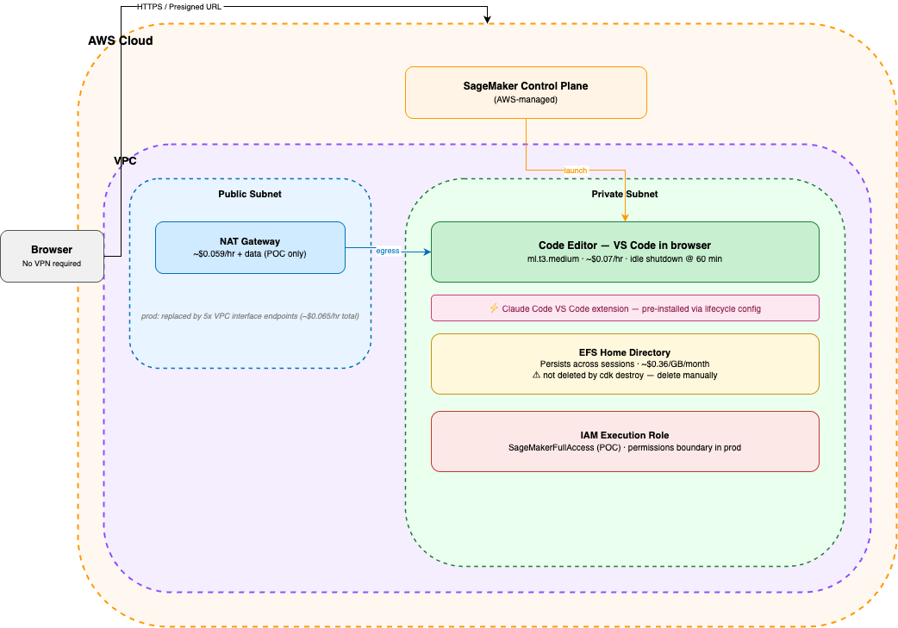
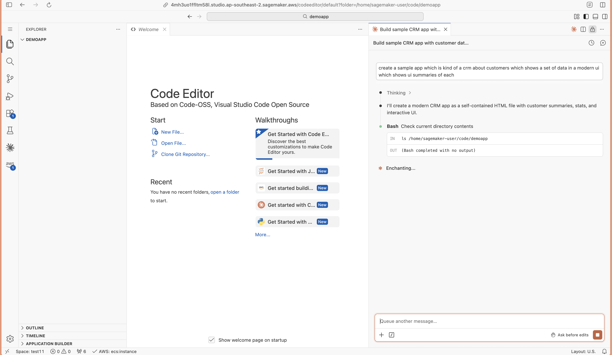

# SageMaker Studio Code Editor With Anthropic Claude Code Extension - CDK v2 Example

Deploy SageMaker Studio with Code Editor (VS Code in browser) into a private VPC using CDK v2. Claude Code VS Code extension is pre-installed via a lifecycle config.

## Architecture



## Prerequisites

- Node.js 18+
- AWS CLI configured with credentials for your target account
- CDK bootstrapped in `ap-southeast-2`:
  ```bash
  npx cdk bootstrap aws://ACCOUNT_ID/ap-southeast-2
  ```

## Screenshot of Code Editor running in SageMaker Studio:


## Deploy (POC)

```bash
npm install
./scripts/deploy.sh
```

Deploys `VpcStack` and `StudioStack`. At the end it prompts to open Studio in the browser — press any key and it opens a presigned URL directly into Code Editor.

The Claude Code VS Code extension is pre-installed automatically via a lifecycle config on first space start.

## Deploy (prod)

```bash
./scripts/deploy.sh --prod --nat-endpoints --user yourname
```

Prod mode uses `VpcOnly` networking and deploys `EndpointsStack` (5 VPC interface endpoints) instead of a NAT Gateway.

## Context flags

| Flag | Default | Effect |
|---|---|---|
| `prod` | `false` | `VpcOnly` networking + tighter IAM |
| `natMode` | `nat` | `nat` = NAT Gateway (POC), `endpoints` = VPC interface endpoints (prod) |
| `userName` | `dev` | SageMaker Studio user profile name |

## Teardown

```bash
npx cdk destroy --all
```

**Important:** SageMaker auto-creates an EFS filesystem when the domain is first used and does **not** delete it on `cdk destroy`. You must delete it manually to avoid ongoing charges:

1. Find the EFS ID in the stack outputs (`EfsId`)
2. Go to EFS in the AWS Console → delete mount targets first, then the filesystem

Or use the cleanup script:

```bash
./scripts/cleanup-efs.sh
```

## Cost (ap-southeast-2)

**POC**

| Resource | Cost |
|---|---|
| Code Editor `ml.t3.medium` | ~$0.07/hr (stopped = $0) |
| NAT Gateway | ~$0.059/hr + data transfer |
| EFS | ~$0.36/GB/month |

**Prod** (`natMode=endpoints`)

| Resource | Cost |
|---|---|
| Code Editor `ml.t3.medium` | ~$0.07/hr (stopped = $0) |
| VPC interface endpoints (×5) | ~$0.013/hr each (~$0.065/hr total) |
| EFS | ~$0.36/GB/month |

Prod swaps the NAT Gateway for 5 VPC interface endpoints. The endpoints run continuously (~$47/month), but there's no data transfer markup and no public internet exposure.

Stop the Code Editor app when not in use to avoid instance charges.
